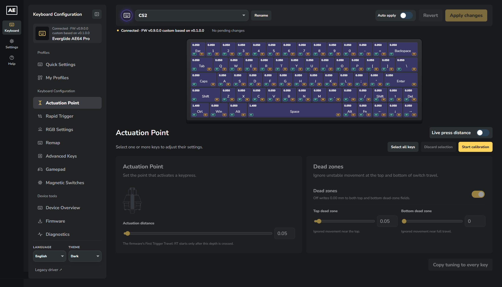
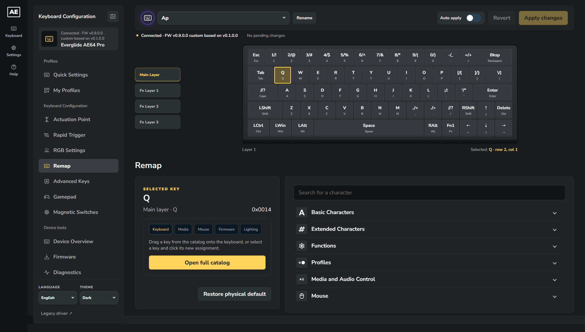
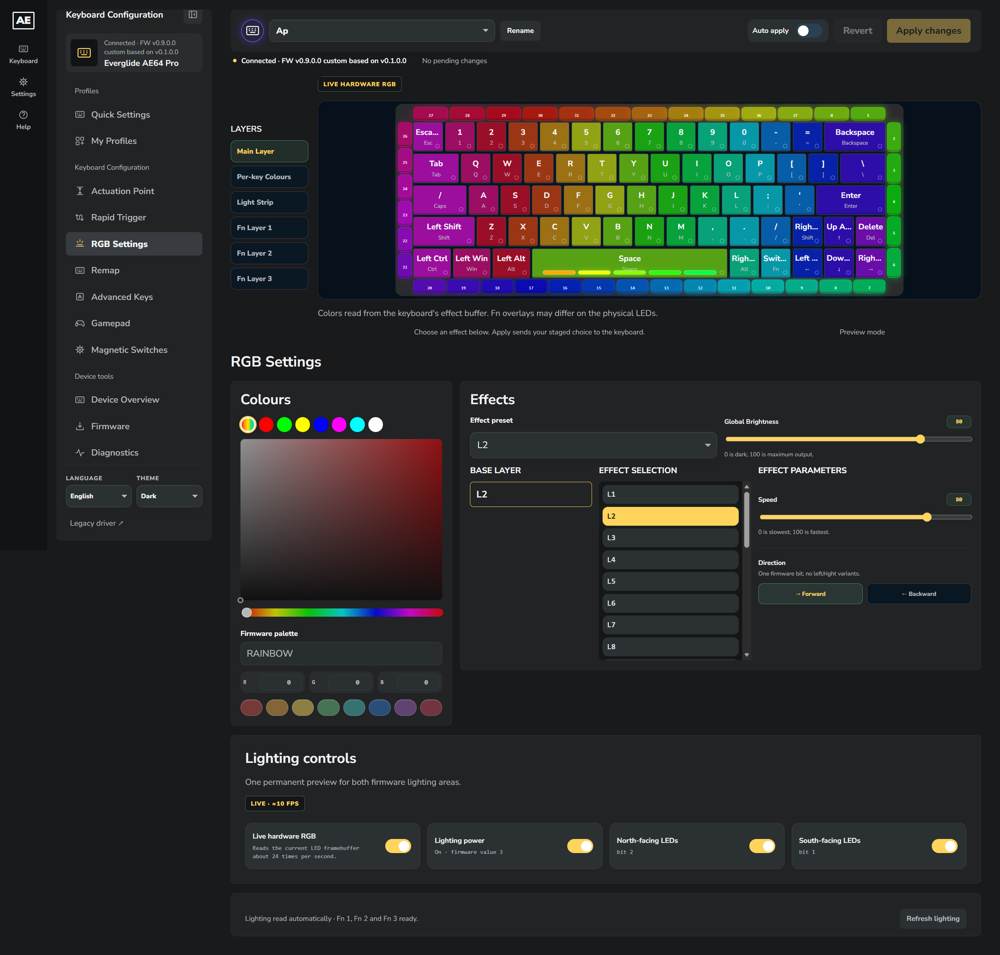
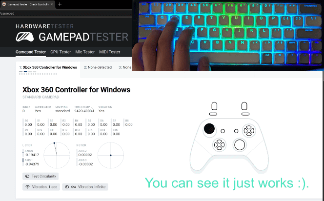
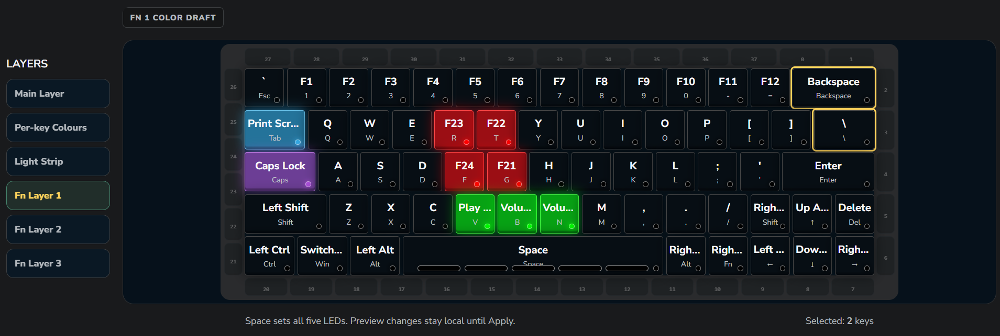
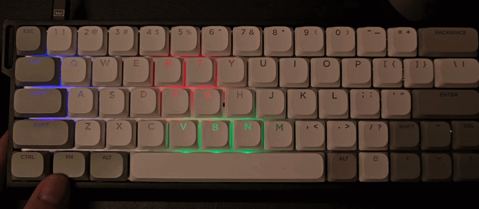
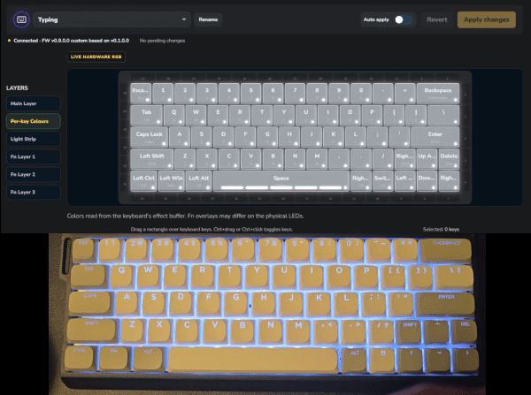

# AE64 Pro Control

  
  

An unofficial WebHID driver for the **Everglide AE64 Pro** magnetic keyboard. Configure keymaps, Hall-effect performance, RGB, advanced key behavior, firmware updates, and custom gamepad output from one browser interface.

The driver is a static website. It communicates directly with the keyboard and does not require an account or the manufacturer’s cloud service.

[Open the web driver](https://tuk3kcs.github.io/everglide-ae64-pro-webdriver/) · [Firmware library](firmware/README.md) · [Firmware research](docs/firmware-research/README.md)

## Unleashing AE64 Pro's full potential using custom firmware

### Controller emulation mode

### Per-key FN layer RGB effect (from Wooting)

### Independent per-key led effect for each profile

## Getting started

Use desktop Chrome or Edge with WebHID support. Connect the keyboard over USB and open the hosted driver, or serve this checkout locally:

~~~powershell
git clone https://github.com/tuk3kCS/everglide-ae64-pro-webdriver.git
cd everglide-ae64-pro-webdriver
python -m http.server 4173 --bind 127.0.0.1
~~~

Open [localhost:4173](http://localhost:4173), then choose **Initialize a device**. Serve the files over HTTPS or localhost. Running the driver needs no bundler or npm installation. Node.js is used for maintenance scripts and offline tests.

GitHub Pages loads assets from a unique URL for each deployment. Open tabs check for updates when they become visible and once a minute while visible. A tab with unapplied edits or an active keyboard operation waits to reload. Hosted drafts and interface settings last for the current page, so export any draft you want to keep. The browser retains the eight recently applied RGB colors and the custom firmware showcase preference. The showcase appears on the first successful connection for each release unless you choose **Understand and do not show again**.

The supported AE64 Pro identifies as USB **1CA6:300A**, board **0030000A**. Firmware files and commands for other keyboards are not interchangeable.

### Stock and custom firmware

AGP1 - indicator that custom firmware is installed in the keyboard

| Feature | Bundled stock firmware (v0.0.5.0 through v0.1.0.0) | Current custom firmware (XInput + per-profile RGB v0.9) |
| --- | --- | --- |
| Keymaps, Hall performance and live travel, advanced actions, macros, standard RGB | Native AE64 configuration interface | Same native configuration interface |
| Gamepad workspace | Read switch travel and edit or export local drafts | Read and apply onboard mappings when AGP1 is verified |
| Xbox controller device switch | Unavailable | Available when AGP1 advertises USB switching |
| Custom Fn1–Fn3 colors | Unavailable | Available when FNR1 is verified |
| Main per-key RGB | Shared across the four onboard profiles | Independent maps when per-profile storage is verified |
| Firmware update and recovery | Board-matched application and recovery workflow | Same board-matched workflow |

The driver displays **v0.9.0.0 custom based on v0.1.0.0** when it reads the v0.9 build marker from the keyboard. Factory images and custom builds before v0.8.1.1 display their native application version. The driver checks extension replies before enabling Gamepad, custom Fn RGB, or per-profile Main RGB controls. The bundled images share the same factory key layout, including the sparse sensor columns used for Enter, Space, Fn, and the arrows.

### Editing workflow

1. Connect and let the driver read the keyboard’s settings.
2. Select the active onboard profile in the sidebar. Each of the four profiles has Main, Fn1, Fn2, and Fn3 keymap layers.
3. Make changes, review the staged edits, then use **Apply changes** to write and verify them. **Revert** discards ordinary staged keyboard edits.

**Apply changes** and **Revert** cover keyboard settings, Gamepad mappings, and custom Fn colors. **Auto apply** saves completed edits as soon as the keyboard is ready. Firmware flashing and the Xbox USB device toggle use their own controls.

## Implemented features

| Area | Available controls |
| --- | --- |
| Overview | Select any virtual key to inspect its mapping, performance and controller assignment, including local-draft versus keyboard-confirmed status. |
| Key mapping | Four layers per profile. Search across Keyboard, Media, Mouse, Firmware, and Lighting from any catalog tab. Create key combinations in Advanced. |
| Performance | Per-key actuation, Rapid Trigger first touch, synchronized or independent RT press/release sensitivity, top/bottom dead zones, and an experimental fixed-release editor. |
| Switches and calibration | An 82-entry switch catalog, per-key switch assignments, multi-key editing, Hall calibration, and live travel/ADC inspection. |
| Advanced | Compact feature cards beside a column of assigned actions; DKS, Multi-Point Trigger, SOCD, Rappy Snappy, Mod-Tap (MT), Toggle (TGL), and End Key (END) editors with verified writes and removable assignments. |
| Macros | A 16-slot editor and keyboard-event recorder; manual Down/Up events, delays, drag reordering, click/hold playback modes, repeat settings, and verified write-back. |
| Lighting | Keyboard effects and palettes, per-key static overrides, north/south LED controls, and independent effects, palettes, and colors for the 38 perimeter LEDs. |
| Device settings | Profile switching/renaming, Windows/macOS mode, firmware-supported polling rates, RGB sleep timer, and shake optimization. |
| Gamepad mode | Native-controller configuration with compatible custom firmware, plus a link to a separate software-mapper solution. |
| Firmware | Bundled or local binary selection, integrity checks, explicit review/start, automatic mode reconnection, and recovery-mode connections. |
| Workspace | Separate JSON import/export controls, English/Vietnamese languages, Mint/Dark/Light themes, diagnostics, and an editable About page. |

The Performance live-distance gauge tracks the furthest pressed key across the keyboard by default. Enable **Track selected keys only** to restrict it to the current selection. Stock and custom firmware use the same native travel-reading command.

Advanced-feature dialogs include configuration guidance and local tutorial videos where available. An implemented editor and offline protocol tests do not establish physical validation of every feature; see [Validation and limitations](#validation-and-limitations).

## Lighting

The Lighting page uses one shared keyboard and light-strip preview. Offline, paused and staged main effects use 20 distinct animated approximations, labeled as such. A clean live preview uses actual RGB frames from the keyboard. Per-key overrides remain visible. Its standard sections are **Keyboard**, **Per-key**, and **Light strip**. Drag a rectangle to select keys or strip LEDs in the corresponding editor; Ctrl/⌘ toggles selection. Selecting Space colors its five physical LEDs together.

On v0.9, select the onboard slot in the sidebar, edit **Per-key** colors and click **Apply changes** to save that slot’s Main overrides. Each slot starts with the previous shared colors until you save its own map. The editor shows which slot will receive the changes. Factory and older custom firmware continue to share Main per-key colors across the onboard slots. Light-strip overrides remain shared on all builds.

### Custom Fn colors

The experimental **XInput + Fn RGB** firmware adds independent static per-key colors for **four onboard profiles × three Fn layers**. The driver shows **Fn 1**, **Fn 2**, and **Fn 3** buttons beside the standard lighting buttons after the keyboard confirms support for the FNR1 extension. Factory firmware retains the standard interface.

- Keyboard and light-strip settings, per-key colors, and all three supported Fn color profiles are read automatically on connection and profile changes. A Refresh lighting button retries failed reads without replacing staged colors.
- Choose the active profile in the sidebar, then select a Fn lighting button. There is no additional profile or layer dropdown inside the editor.
- The shared keyboard switches to that Fn layer’s color draft. Drag on it to select keys, then choose a color; black turns a selected key off.
- Enable the layer’s custom colors and use **Apply changes** in the top bar to save them, or enable **Auto apply**.
- Holding a key mapped to that Fn layer displays the saved static colors on the keyboard. Releasing Fn restores the normal effect. Disabling custom colors restores the factory Fn action-group colors.

Fn colors persist in the keyboard’s profile storage. They use the factory Fn intensity convention rather than the normal effect’s brightness slider. During editing, the preview shows the selected color draft, not a live reading of the physical Fn overlay. The perimeter strip keeps its normal settings and is not selectable in the Fn editor.

See the [Fn RGB guide](docs/firmware-research/fn-rgb/README.md) for firmware evidence, storage accounting, and hardware-validation limits.

## Gamepad mode

**Gamepad mode** sits between Advanced and Lighting in the sidebar.

### Hardware Solution

Compatible custom firmware exposes native Xbox/XInput controller output on Windows while retaining the keyboard’s configuration interface. Once the driver confirms that firmware, it hides the firmware-setup panel and **automatically reads the keyboard’s gamepad profile**. All 64 physical keys’ travel limits are read automatically, including when cached switch settings already exist. The read button remains available for refresh or retry. A previously confirmed local copy follows the active keyboard profile; unsaved edits stay a separate local draft. The Assign workspace uses the full page width, with tuning and stick behavior below it. No controller action is selected on entry. Select an assigned key or choose an action to open tuning. Automatic loading does not upload a configuration; a failed read retains the local draft.

Assign physical keys to LT/RT triggers, all four directions of both sticks, A/B/X/Y, bumpers, Back/Start, stick presses, and D-pad buttons. Analog controls support adjustable travel windows, linear/smooth response, circular stick gates, radial dead zones, and opposing-direction policies. Digital buttons follow the key’s normal actuation and Rapid Trigger state.

Controller icons appear in the assignment picker, mapped keys, and Overview. Overview distinguishes local drafts from assignments read or confirmed on the connected keyboard; Gamepad off dims the preserved mappings.

#### Output modes

| Mode | Assigned physical keys | Unassigned keys |
| --- | --- | --- |
| Controller assignment only | Send controller input and suppress their normal keyboard input. | Work as keyboard keys. |
| Keyboard + Controller | Send both inputs, each according to its own travel/actuation settings. | Work as keyboard keys. |
| Gamepad off | Send normal keyboard input; controller output is neutral and mappings are preserved. | Work as keyboard keys. |

Use the top-bar **Apply changes** after changing modes or mappings, or enable **Auto apply**. Gamepad off mutes controller output. The Xbox USB device switch controls whether Windows sees the controller.

From **v0.3** onward, the separate **Xbox controller device** switch removes or restores the controller interface through a brief USB reconnect. The driver verifies the same keyboard and requested state before reporting success. In v0.8.1 and newer, this choice is saved across power loss and applies across onboard profiles. After upgrading from v0.8, turn it off once to save the disabled preference. Earlier builds keep the choice until power loss. A keyboard without a saved preference starts enabled. Windows may retain historical hidden device entries. v0.2 keeps the switch disabled. See the [USB persistence report](docs/firmware-research/gamepad/USB_PERSISTENCE_V081.md).

#### Switch-aware travel defaults

Defaults use each physical key’s selected switch profile and catalog range, capped by its known keyboard-reported limit. Mixed-switch keyboards are supported. For **UR Ice Magnetic**, the default switch travel and full-output point are **3.31 mm**, with a **0.50 mm** start.

New assignments and restored examples use those per-key limits. Legacy 4.00 mm defaults, including factory-default gamepad ranges read from the keyboard, are adapted in the local draft. Custom windows such as 1–3 mm, explicit maximum overrides, and imported profiles are preserved where applicable. Automatically managed windows are shortened when needed to fit a smaller range.

If switch metadata is unavailable, the driver attempts to read the keyboard’s limits automatically. **Refresh travel limits** retries the device read. Apply still checks the actual keyboard limits before uploading.

**v0.4 and newer save applied gamepad mappings in the active onboard profile.** Apply once after upgrading, then the saved assignments, output mode, ranges and stick settings are restored after power loss. A profile without a valid saved mapping starts empty. v0.2/v0.3 remain session-only. Browser drafts are kept separately and automatic connection reads no longer overwrite them; Apply activates/saves the draft, while an explicit Read replaces it with the keyboard’s settings. See the [v0.4 reconnect fix](docs/firmware-research/gamepad/RECONNECT_FIX_V04.md). **v0.5 fixes simultaneous controller keys and release updates** by preserving the native scanner’s event history around keyboard suppression; see the [rollover investigation](docs/firmware-research/gamepad/ROLLOVER_FIX_V05.md). **v0.6 adds explicit normal-key releases** and keeps suppression active through sensor faults and pending USB changes; see the [keyboard-release fix](docs/firmware-research/gamepad/KEYBOARD_RELEASE_FIX_V06.md). **v0.7 adds exact physical keyboard-output gates, momentary Fn press ownership and a real millisecond clock.** It also stages Transparent above Fn triggers and requests a prompt LED frame on layer changes. See the [input/Fn/timing report](docs/firmware-research/gamepad/INPUT_FN_TIMING_FIX_V07.md). **v0.8 removes repeated scan/release processing, caches controller calculations and corrects the sparse physical matrix.** See the [optimization report](docs/firmware-research/gamepad/SCAN_FN_OPTIMIZATION_V08.md); physical LED latency remains to be measured.

### Software Solution

The Software Solution opens the separate [Hall Analog Mapper project](https://github.com/z750sasr/he-kb-analog-mapper) for users who prefer a software solution with factory firmware. That application is maintained separately and is not installed or run by this website.

The controls are integrated into the main driver; there is no standalone /gamepad page. Keyboard-workspace, gamepad, and Fn-color backups use their respective import/export controls.

## Firmware updates and recovery

The [firmware directory](firmware/README.md) contains five unchanged factory releases and four experimental **XInput + RGB** releases through v0.9. The Firmware tab lists files from its generated catalog and also accepts a local binary.

1. Export settings and gamepad/Fn-color backups you want to retain.
2. Connect the intended keyboard, open **Firmware**, and choose an image.
3. Review its identity, size, and hash, then choose **Start firmware update**.
4. Keep USB connected while the driver writes, validates, restarts, and reconnects the keyboard.

The driver checks the container header, board ID, payload length, CRC-32, and catalog size/SHA-256 where available. It sends the complete image, requires the keyboard’s validation response before restarting, and excludes ordinary configuration traffic during the update.

Bootloader and application transitions reconnect automatically when the browser already permits access to those USB modes. The reviewed firmware stays selected through the handoff. If a mode needs browser permission, use **Allow recovery keyboard** or **Allow restarted keyboard** on the progress panel; the same update continues after selection without refreshing or reselecting its image. Automatic matching retains identity checks, and an explicit selection is still checked for board and run mode. Unresolved reconnection failures stop the update and offer **Reconnect keyboard**.

The normal **Connect keyboard** flow also accepts recovery mode. A recovery keyboard opens Firmware, clears the previous image selection, and requires a fresh firmware choice and explicit Start. Ordinary configuration pages remain unavailable in recovery mode. An authorized recovery replug is detected when no other keyboard session is active. Reconnecting through the Firmware panel after a failed update retains the selected image for review and a complete fresh transfer. Interrupted partial transfers are not silently resumed.

To add or replace an image, put the .bin under firmware/ and regenerate the catalog:

~~~powershell
node scripts/build-firmware-catalog.cjs
~~~

GitHub Pages regenerates the catalog and packages the actual binaries during deployment. Flashing/recovery on physical hardware is not guaranteed by file checks or simulated tests.

## Validation and limitations

- The driver’s packet codecs, editors, read-back workflows, image streams, reconnect/recovery logic, and UI behavior have offline regression coverage. Recent browser UI checks use simulated devices.
- The earlier experimental XInput v0.1 image was flashed separately by the user. Follow-up read-only checks observed Windows Xbox 360 controller enumeration, custom protocol replies, and a connected XInput device. This does not validate every analog behavior or later firmware changes.
- On November 9, 2026, the maintainer reported completing physical-keyboard testing of v0.8.1 with no issues observed in that round. The v0.8.1.1 version marker passed linked-image and browser tests. See [physical keyboard testing](docs/firmware-research/VALIDATION.md#physical-keyboard-testing).
- Gamepad mappings persist in v0.4 and newer; v0.2/v0.3 mappings remain volatile. Fn colors are designed to persist; factory resets or later factory keymap saves can erase them. Export backups before changing firmware. Native flash saving inherits an erase/rewrite power-loss risk.
- Factory restore is visible but disabled pending physical-device verification. Additional catalog-only lighting effects and extended right-side modifier combinations remain experimental.

## Development and checks

The app uses ordered classic scripts rather than a bundler; preserve the load order in index.html. Main UI modules are under js/app/, gamepad controls under js/gamepad/, firmware transfer/reconnect logic under js/firmware/, and the custom Fn protocol client under js/lighting/. Local assets include switch data/images, controller icons, and tutorial videos.

Run the same offline checks used by GitHub Pages:

~~~powershell
node scripts/build-firmware-catalog.cjs
node smoke-test.cjs
node tests/device-serial-tests.cjs
node tests/performance/live-gauge-tests.cjs
node tests/firmware/flasher-tests.cjs
node tests/firmware/ui-tests.cjs
node tests/firmware/reconnect-tests.cjs
node tests/firmware/recovery-tests.cjs
node tests/firmware/handoff-tests.cjs
node tests/gamepad/tests.cjs
node tests/gamepad/protocol-tests.cjs
node tests/gamepad/travel-limits-tests.cjs
node tests/gamepad/switch-defaults-tests.cjs
node tests/gamepad/icons-overview-tests.cjs
node tests/gamepad/auto-load-tests.cjs
node tests/gamepad/automatic-sync-tests.cjs
node tests/gamepad/overview-selection-tests.cjs
node tests/gamepad/usb-switch-tests.cjs
node tests/gamepad/usb-reconnect-tests.cjs
node tests/lighting/fn-ui-tests.cjs
node tests/lighting/automatic-read-tests.cjs
node tests/lighting/fn-selection-tests.cjs
node tests/lighting/fn-mapping-tests.cjs
node tests/lighting/fn-protocol-tests.cjs
node tests/lighting/effect-preview-tests.cjs
~~~

These checks use simulated transports and do not open a real keyboard. Optional compiled-C harnesses provide additional protocol verification. Firmware build requirements, commands, symbols, and image audits are documented in the [custom firmware guide](firmware/custom/ae64-xinput/README.md).

Further documentation:

- [AE64 protocol](docs/AE64_PROTOCOL.md)
- [Switch catalog names, grouping, and images](docs/SWITCH_CATALOG_OVERRIDES.md)
- [Key combinations and onboard limits](docs/KEY_COMBINATIONS_AND_MEMORY.md)
- [Firmware reverse engineering and reconstructed version changes](docs/firmware-research/README.md)
- [Custom Fn lighting](docs/firmware-research/fn-rgb/README.md)

## Contributing

The project is evolving quickly. Help by testing the driver and [reporting reproducible issues](https://github.com/tuk3kCS/everglide-ae64-pro-webdriver/issues). Include the firmware version, browser/OS, active profile, steps to reproduce, and expected versus actual behavior. State whether the issue involves factory or custom firmware, and remove private information from attached logs or captures.

Please coordinate significant changes with the maintainers before starting. Editorial switch names and images belong in the catalog overrides rather than changes to the captured firmware values.
