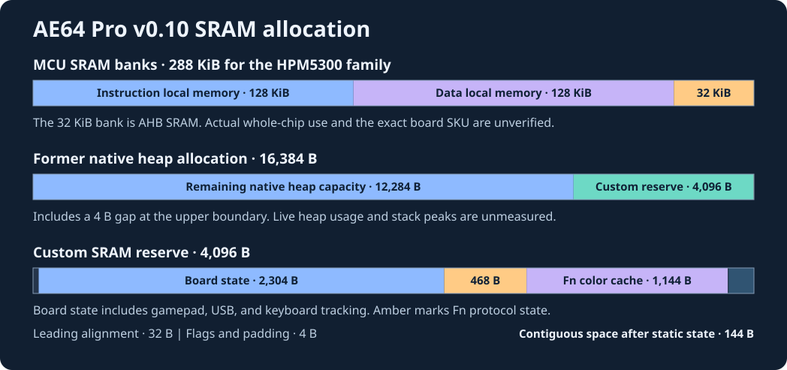
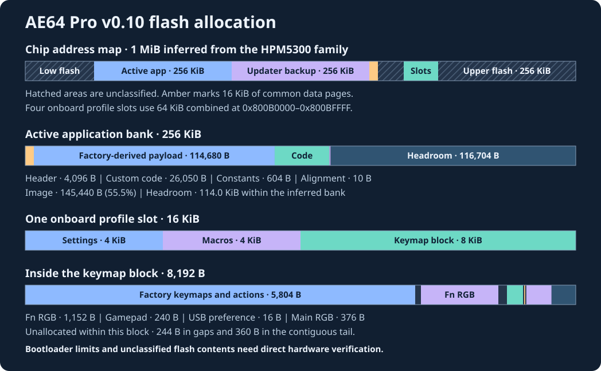

# Gamepad polling and MCU headroom in AE64 Pro v0.10

## AE64 Pro report timing

When Xbox emulation is enabled, v0.10 can submit a **20-byte XInput report once per 1 ms firmware tick**, for a maximum sustained rate of about **1,000 reports per second**. The report comes from the latest processed Hall scan state. The firmware can submit an unchanged state and waits for the previous transfer to complete before it queues another report. Time spent in the shared scheduler or servicing USB can lower the observed rate.

The keyboard and controller share the Hall scanner and native scheduler. They have separate USB endpoints and separate report timing. The normal keyboard report-rate command changes the native HID setting. The XInput scheduler still checks the hardware-derived millisecond tick, irrespective of that keyboard setting. The scheduler runs the stock work first, so heavy native work can still affect when the controller gets serviced. [Keyboard report-rate command](../../../protocol.js#L297-L307) · [Board scan and scheduling hooks](../../../firmware/custom/ae64-xinput/source/board/board_port.c#L576-L641) · [XInput submission and transfer ownership](../../../firmware/custom/ae64-xinput/source/src/ae64_xusb.c#L96) · [Timer binding](../../../firmware/custom/ae64-xinput/source/board/memory.ld#L34-L35)

| Stage | Cadence or limit |
| --- | --- |
| Hall sensing | Factory scan path supplies the data. Complete-matrix scan cadence under load has yet to be measured. |
| XInput report submission | One report per 1 ms tick at most over sustained operation. |
| USB interrupt IN endpoint `0x85` | Advertises `bInterval=1` at both speeds. That requests a service opportunity every 1 ms at full speed or 125 µs at high speed. |
| Game | Reads state on its own schedule through Windows or its input library. |

The high-speed endpoint can have eight service opportunities per millisecond while v0.10 only queues about one report in that time. A USB descriptor reading and an application-level polling test can therefore report different numbers. I reran the v0.10 timing harness and all **12,613 checks** passed, including simulated millisecond rollover, in-flight transfer ownership and a stalled scheduler clock. This was an offline run. [Descriptor construction](../../../firmware/custom/ae64-xinput/source/board/board_port.c#L514-L526) · [Microsoft USB endpoint descriptor](https://learn.microsoft.com/en-us/windows-hardware/drivers/ddi/usbspec/ns-usbspec-_usb_endpoint_descriptor) · [v0.10 verification record](../../../firmware/custom/ae64-xinput/v0.10/verification.json)

## Wooting's configuration

Wootility 5.4.2 exposes **250 Hz, 1,000 Hz and 8,000 Hz**. Its device configuration stores the gamepad interval separately from the keyboard USB mode. The full 8,000 Hz option requires high-speed-capable hardware and high-speed mode enabled. When a stored 8,000 Hz preference meets an active full-speed configuration, Wootility displays 1,000 Hz. The UI describes 250 Hz as a compatibility or stability option. These are independent settings within a shared USB speed limit. The analyzed evidence establishes configuration and UI behavior. Packet phase and on-wire fallback behavior would require a Wooting USB capture. [Wootility 5.3.0 release](https://wooting.io/wootility/changelogs/5.3.0) · [Wooting’s USB high-speed compatibility article](https://help.wooting.io/article/325-keyboard-not-detected-on-startup-until-reconnected-8000)

Static evidence comes from the installed Wootility 5.4.2 renderer `index-AyD-fgiJ.js`, SHA-256 `adc15b26f48001092ae800cff2859126c34b538b3b8840fb06bde414a2282577`. Decoded character offsets are approximately `4208284` for the option table, `4208383` for capability rules, `4260441` for the displayed rate, and `1732654` for the separate setter. The analysis record is `ev_140d0e74ff108e2759b76ef2740aa5046ffc69e3c2368f81e53f9ec33cc9f54e`.

## Games and the value of a lower setting

- Microsoft’s XInput guidance reads the latest controller state each game frame and offers a packet number to detect state changes. A 120 FPS game that follows that pattern reads roughly every 8.33 ms. A faster controller can supply fresher data for that read. Microsoft's newer GameInput also exposes per-reading history, so behavior varies by game and input API. [XInput guidance](https://learn.microsoft.com/en-us/windows/win32/xinput/getting-started-with-xinput) · [GameInput reading history](https://learn.microsoft.com/en-us/gaming/gdk/docs/reference/input/gameinput/interfaces/igameinput/methods/igameinput_getnextreading?view=gdk-2510)
- A reported Roblox client freeze reproduced at 4,000 Hz and above on the affected setup, with 1,000 Hz working. Roblox staff rolled out a fix and the original reporter confirmed it. This is a concrete compatibility case at very high controller rates. The reviewed sources did not establish a widespread problem at 1,000 Hz. [Roblox engine bug and resolution](https://devforum.roblox.com/t/controllers-with-a-report-rate-of-4000hz-or-higher-freeze-the-game-client/4686196)
- Mixed mouse and controller input can produce its own compatibility problems. Wooting documents games that cannot accept both together, and Epic documents a Fortnite controller issue addressed by changing the game's input lock. These have a different cause from controller report timing. [Wooting mixed input help](https://help.wooting.io/article/148-use-wooting-keyboard-with-rewasd-for-controlling-the-right-joystick-with-a-mouse) · [Epic Fortnite support](https://www.epicgames.com/help/c-34254770/c-33726977/pc-a20977468)

The legacy Xbox USB reference descriptor uses a 4 ms controller interval, which corresponds to 250 Hz. At 1,000 Hz the interval is 1 ms, and at 8,000 Hz it is 0.125 ms. For input arriving uniformly between perfectly spaced reports, 250 Hz adds 1.5 ms of average waiting compared with 1,000 Hz. Moving from 1,000 to 8,000 Hz can save about 0.44 ms of average waiting in that same stage. Hall sensing, USB transfer, game processing and rendering contribute additional latency. An empirical study that included nine gamepads found varying benefits from 1,000 Hz host polling across the devices it tested. [Microsoft Xbox USB controller endpoint](https://learn.microsoft.com/en-us/openspecs/windows_protocols/ms-xusbi/9a73b2ba-14a2-412b-aa0c-5e2830f41850) · [USB input latency study](https://epub.uni-regensburg.de/40182/1/On_the_Latency_of_USB-Connected_Input_Devices_author_version.pdf)

**Keep the controller at 1,000 Hz and independent of the keyboard setting.** A 250 Hz compatibility mode is worth revisiting if a specific Windows setup or game shows a repeatable problem at 1,000 Hz that clears at 250 Hz. An A/B test should isolate the controller endpoint interval from the report submission limit. Slowing report submission alone leaves the endpoint's advertised interval in place.

## MCU speed and build budgets

The shipped v0.10 image preserves the factory clock setup. In the stock payload, `0xE33A–0xE344` selects PLL0CLK0 for CPU0 with divide-by-2 and an AHB divide-by-3. `0xE348–0xE37C` sets post-divider code `0` for that output and configures PLL0 for 960 MHz. The associated routines at `0x14288` and `0x13574` are also byte-identical in v0.10. The sequence matches HPMicro's HPM5300 reference setup for **480 MHz core and 160 MHz AHB**, which are nominal firmware-configured rates. The exact chip SKU and live clocks have yet to be verified directly on this board. HPMicro lists 288 KiB SRAM for the family, split between local instruction and data memories and AHB SRAM. [Reference clock setup](https://github.com/hpmicro/hpm_sdk/blob/main/boards/hpm5300evk/board.c#L209-L224) · [PLL divider implementation](https://github.com/hpmicro/hpm_sdk/blob/main/drivers/src/hpm_pllctlv2_drv.c#L134-L142) · [HPM5300 datasheet](https://www.hpmicro.com/Public/Uploads/uploadfile/files/20250205/HPM5300DSV011.pdf)

### SRAM

The patch reserves **4,096 B** at `0x0008A960–0x0008B95F` from the factory heap, leaving **12,284 B** of native heap capacity and a 4 B boundary gap. The **3,920 B** of custom static state consists of **2,304 B** of board state, **468 B** of Fn RGB protocol state, **1,144 B** of Fn RGB cache, and **4 B** of flags and padding. The **176 B** outside static state breaks down into **32 B** of leading alignment and **144 B** of contiguous space at the end of the reservation. Total free SRAM depends on bank mapping, native allocations, and peak stack and heap usage. [v0.10 build manifest](../../../firmware/custom/ae64-xinput/v0.10/build-manifest.json) · [Linker allocation](../../../firmware/custom/ae64-xinput/source/board/memory.ld#L5-L17) · [Factory startup memory map](../hardware/STARTUP_MEMORY_MAPS.md)

### Flash storage

| Flash region | Address range, inclusive | Size |
| --- | --- | ---: |
| Unclassified low flash | `0x80000000–0x8001FFFF` | 128 KiB |
| Active application bank | `0x80020000–0x8005FFFF` | 256 KiB |
| Updater backup | `0x80060000–0x8009FFFF` | 256 KiB |
| Region containing common data such as calibration and shared RGB | `0x800A0000–0x800A3FFF` | 16 KiB |
| Unclassified gap | `0x800A4000–0x800AFFFF` | 48 KiB |
| Four onboard profiles | `0x800B0000–0x800BFFFF` | 64 KiB |
| Unclassified upper flash on the inferred 1 MiB device | `0x800C0000–0x800FFFFF` | 256 KiB |

The active-bank image uses **145,440 B**, including its **4,096 B** header. The remainder of that bank is **116,704 B** of nominal growth room beyond the image. The bank boundary comes from the native updater's copy range. The bootloader's accepted image limit is still unverified. [Native boot-entry trace](../protocol/NATIVE_HANDLERS.md#L118-L119) · [Factory calibration storage](../../AE64_PROTOCOL.md#hall-travel-conversion-and-switch-storage) · [Factory lighting storage](../../AE64_PROTOCOL.md#lighting)

Each 16 KiB profile has two 4 KiB pages for settings and macros, followed by an 8 KiB keymap block. The table shows where custom records sit in that block. The **360 B contiguous tail** is per profile.

| Keymap block offset, inclusive | Record | Bytes per profile |
| --- | --- | ---: |
| `+0x0000–+0x16AB` | Factory keymaps and actions | 5,804 |
| `+0x1700–+0x1B7F` | Fn1–Fn3 RGB | 1,152 |
| `+0x1C00–+0x1CEF` | Gamepad mappings and curves | 240 |
| `+0x1D00–+0x1D0F` | USB visibility preference record | 16 |
| `+0x1D20–+0x1E97` | Main per-key RGB | 376 |
| `+0x1E98–+0x1FFF` | Unallocated contiguous tail | 360 |
| Gaps between records | Alignment and spacing | 244 |

The native keymap save erases the full block, and the custom save path restores its records. [Factory profile layout](../fn-rgb/fn-storage/FINDINGS.md#proven-native-layout) · [RGB record layout](../../../firmware/custom/ae64-xinput/source/board/fn_storage.h) · [Gamepad record layout](../../../firmware/custom/ae64-xinput/source/board/gp_storage.h)

### Runtime measurement

The scan test counted 310,000 native-RAM accesses over 10,000 idle scans with six mapped keys, down from 3,630,000 in the old hook. That fixture excludes the factory scan cost. A 480 MHz core has a nominal 480,000 cycles per millisecond shared by all workloads. Measuring actual load would require cycle or GPIO timing on target, heap and stack high-water counters, and a USB trace under idle and mixed gamepad, keyboard and RGB use. [Scan comparison](SCAN_FN_OPTIMIZATION_V08.md#L20-L31)
